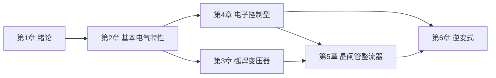

# 弧焊电源 MOC

> 《电力电子和焊接电源》课件全 6 章 / **273 页幻灯片**，逐页一篇笔记 + 47 张概念卡 + 公式库；每条结论都能点回原页，红字重点单独汇总。

## 快速入口

| 我要… | 去 |
| --- | --- |
| 系统学一遍 | [[03 学习路径]] |
| 查公式 | [[公式总表]] |
| 按概念跳转 | [[04 概念地图]] |
| 只看老师标红 | [[05 红色重点总表]] |
| 核对页码 | [[02 目录与页码对照]] |
| 做复习题 | [[复习题与思考题]] |
| 查表查图 | [[数据表与图注索引]] |
| 中英术语 | [[术语中英对照]] |
| 了解建库方式 | [[00 关于本知识库]] |

## 六章

### 第一章 绪论

`16 页` · `p001–p016` · `14 条标红` · 导航：[[00 第1章 绪论 导航]]

首篇：[[p001 电力电子和焊接电源|p001]]　末篇：[[p016 1.4 本课程的目的和主要内容|p016]]

### 第二章 弧焊电源的基本电气特性

`66 页` · `p017–p082` · `37 条标红` · 导航：[[00 第2章 基本电气特性 导航]]

首篇：[[p017 本章导览|p017]]　末篇：[[p082 弧焊电源的基本特性？主要包括哪几种？|p082]]

### 第三章 弧焊变压器

`53 页` · `p083–p135` · `13 条标红` · 导航：[[00 第3章 弧焊变压器 导航]]

首篇：[[p083 本章导览|p083]]　末篇：[[p135 常用增强漏磁式弧焊变压器的外特性曲线的获得及其形状有|p135]]

### 第四章 电子控制型弧焊电源

`53 页` · `p136–p188` · `15 条标红` · 导航：[[00 第4章 电子控制型 导航]]

首篇：[[p136 本章导览|p136]]　末篇：[[p188 电子控制弧焊电源的外特性调节实际上是调节U。和Ugu|p188]]

### 第五章 晶闸管弧焊整流器

`47 页` · `p189–p235` · `6 条标红` · 导航：[[00 第5章 晶闸管整流器 导航]]

首篇：[[p189 本章导览|p189]]　末篇：[[p235 锯齿波同步切割式移相触发电路|p235]]

### 第六章 逆变式弧焊电源

`38 页` · `p236–p273` · `14 条标红` · 导航：[[00 第6章 逆变式 导航]]

首篇：[[p236 本章导览|p236]]　末篇：[[p273 6.5.3 调节特性控制|p273]]

## 手写笔记（拍照讲义）

`118 页笔记`（1~5周 57 页 · 6~8周 61 页）· `108 处自动划线重点`

[[00 手写笔记总览|手写笔记总览]] 是入口；老师在课上标"重点/补考题"的 11 张实拍另见 [[00 课堂实拍总览|课堂实拍总览]]（含转录与考点）：每页内嵌整页扫描图、OCR 文字、自动标记的重点，并挂回对应讲义页。
属性区已折叠（`折叠属性.css`），悬停即展开。

## 全库统计

| 项 | 数 |
| --- | --- |
| 讲义页 | 273 |
| 手写笔记页 | 118 |
| 课堂实拍重点 | 11 |
| 概念卡 | 47 |
| 章导航 | 6 |
| 标红重点 | 99 |
| 幻灯片 | 273 |
